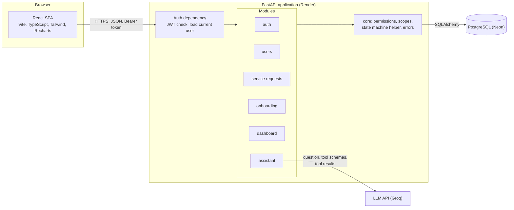
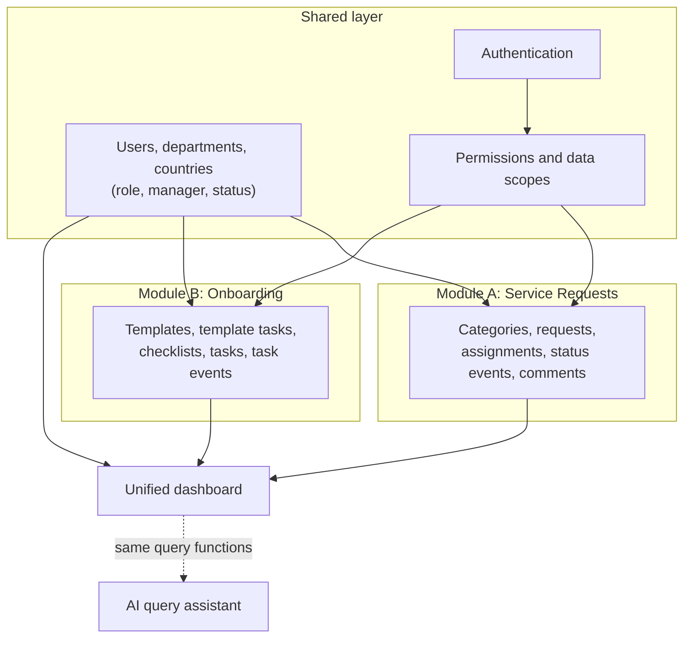
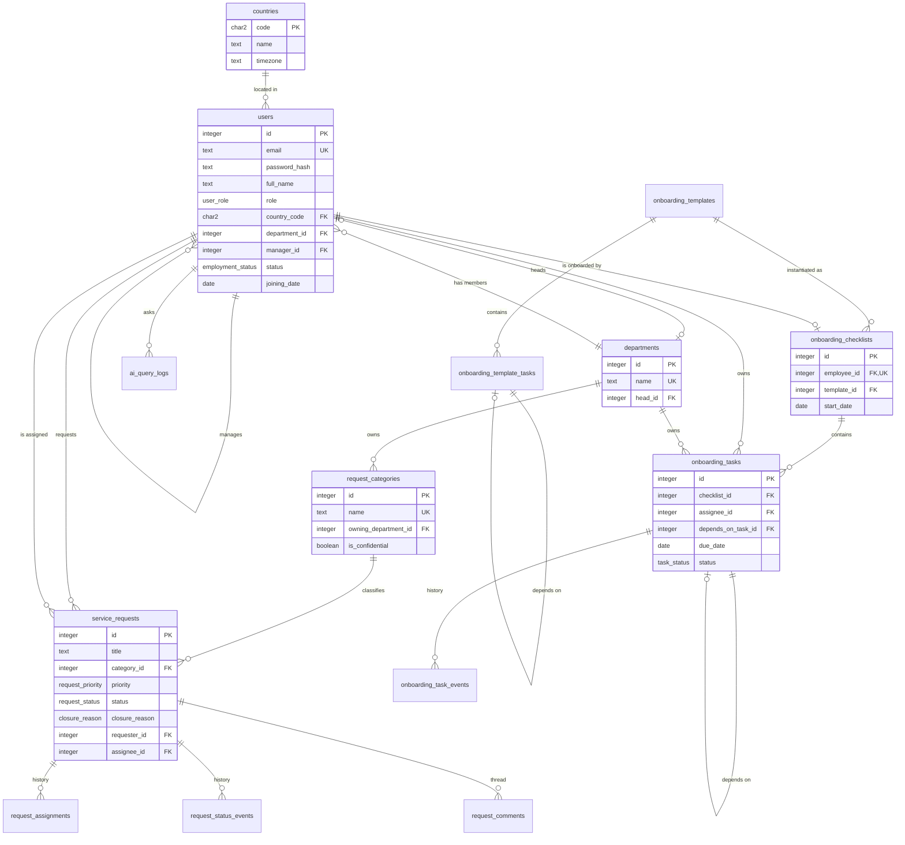
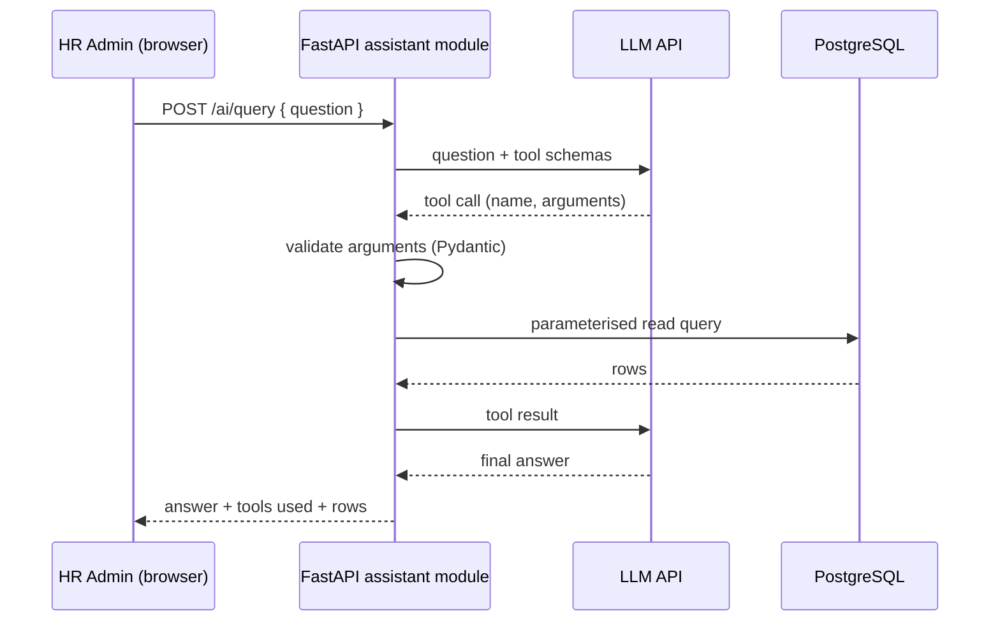
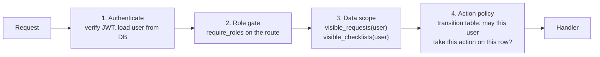
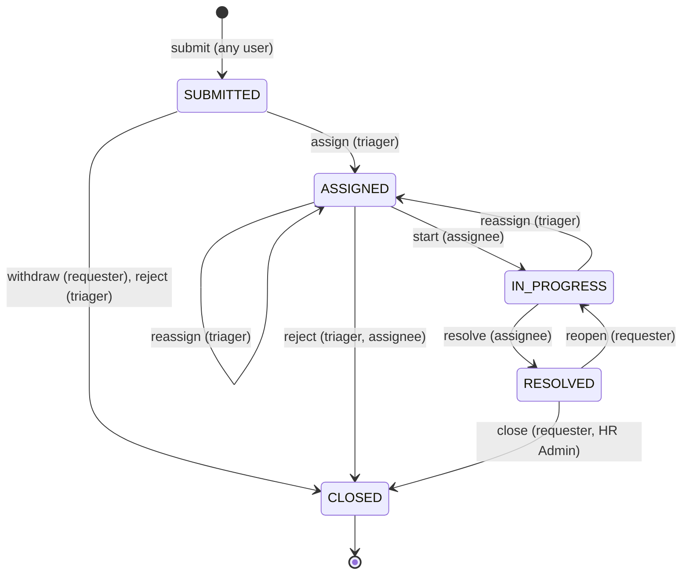
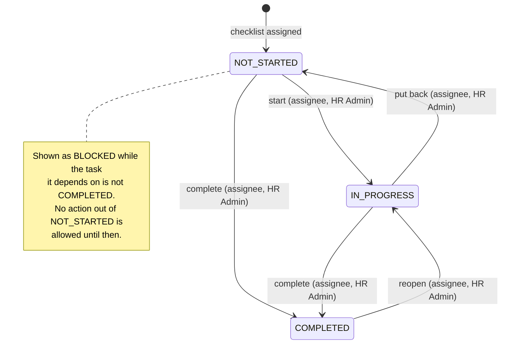

# Architecture

Service Request & Employee Onboarding Platform for a 100-person company operating in Bangladesh, Malaysia, Sri Lanka and Cyprus.

The platform has two workflow modules, **Service Requests** and **Onboarding**, built on one shared layer: a single user directory, one login, one set of access rules, and one dashboard that reads from both.

Contents:

1. [High-level architecture](#1-high-level-architecture)
2. [Data model](#2-data-model)
3. [API design](#3-api-design)
4. [Access control design](#4-access-control-design)
5. [State machine design](#5-state-machine-design)
6. [Trade-off notes](#6-trade-off-notes)
7. [Invariants](#7-invariants)
8. [Assumptions and scope](#8-assumptions-and-scope)
9. [Testing approach](#9-testing-approach)

---

## 1. High-level architecture

### 1.1 Components



| Component | Technology | Responsibility |
|---|---|---|
| Frontend | React, Vite, TypeScript, Tailwind CSS, Recharts, hosted on Vercel | Role-aware UI. Shows only the actions the API reports as allowed. Holds no business rules. |
| Backend | FastAPI, SQLAlchemy 2 with the synchronous psycopg driver, Alembic, Pydantic v2, hosted on Render | All business rules: authentication, access scopes, state transitions, date calculation, aggregation. |
| Database | PostgreSQL, hosted on Neon | Single source of truth. Enforces integrity with foreign keys, enums, unique and check constraints. |
| AI service | Groq chat-completions API with function calling (model name set by environment variable) | Turns an HR Admin's question into calls to a fixed catalogue of read-only query tools, then phrases the answer. Never touches the database directly. |

The backend is a **modular monolith**: one application, deployed as one unit, whose code is divided into one module per business area. Each module keeps its own routes (URLs), schemas (request and response shapes), models (tables) and service functions (the business rules). When one module needs something from another, it calls that module's service function; it does not query the other module's tables itself. The dashboard is the deliberate exception, because reading across modules is its whole purpose.

### 1.2 How the modules relate



What is shared, and therefore exists exactly once:

- **People.** Requesters, assignees, comment authors, new hires, task owners and managers are all rows in `users`. Neither module stores a copy of a name, country or department.
- **Reporting line.** Every user row has a `manager_id` column holding the id of that person's manager. A manager's team is every user whose `manager_id` holds that manager's id. Both modules use this one column, so "team" means the same thing for team requests and for direct reports' onboarding.
- **Departments.** A request category is owned by a department; an onboarding task is owned by a department. Both point at the same `departments` table, and both use the same department head as the default owner.
- **Access rules.** One permissions module answers "what can this user see?" for both workflows.
- **Transition handling.** Both state machines are declared as tables of allowed actions. One small helper checks that an action is allowed from the current status and for this actor; each module then applies the change and records its history row in the same transaction.
- **Read models.** The dashboard and the AI assistant call the same aggregation functions, so both use one definition of terms like "open" and "overdue".

### 1.3 Code layout

```
backend/
  app/
    core/          config, database session, security, auth and role dependencies,
                   state machine helper, errors
    modules/
      auth/        login, logout, current user
      users/       directory, departments, countries
      requests/    categories, requests, assignments, comments
      onboarding/  templates, checklists, tasks
      dashboard/   cross-module aggregates
      assistant/   LLM client, tool catalogue, query endpoint
    seed/          deterministic seed script
  alembic/         migrations
  tests/
frontend/
  src/
    api/           typed API client
    features/      one folder per domain, mirroring the backend modules
    components/    shared UI
    lib/           formatting helpers
```

---

## 2. Data model

### 2.1 Entity-relationship diagram



### 2.2 Tables

Conventions:

- Every table has an auto-incrementing `integer` primary key `id`, except `countries`, which is keyed by its ISO code.
- All timestamps are `timestamptz` stored in UTC.
- Enumerated values are PostgreSQL enum types, so an invalid status cannot be written by any code path.
- Workflow records are never deleted. Requests, checklists, tasks and their history have no delete endpoint, and their foreign keys keep PostgreSQL's default behaviour, which refuses to delete a row that others still point to, so history cannot disappear with its parent. Users and templates are deactivated, not deleted.

#### Shared

**`countries`**

| Column | Type | Constraints |
|---|---|---|
| code | char(2) | primary key (ISO 3166 code) |
| name | text | not null, unique |
| timezone | text | not null; IANA name used to decide the local date |

Seeded with `BD` Bangladesh (`Asia/Dhaka`), `MY` Malaysia (`Asia/Kuala_Lumpur`), `LK` Sri Lanka (`Asia/Colombo`), `CY` Cyprus (`Asia/Nicosia`).

**`departments`**

| Column | Type | Constraints |
|---|---|---|
| name | text | not null, unique |
| head_id | integer | nullable, FK `users`; the person who receives the department's work by default |

Seeded with Engineering, People & Culture, Finance, Marketing, IT, Operations, Compliance.

**`users`** (every employee is a user; there is no separate employee table)

| Column | Type | Constraints |
|---|---|---|
| email | text | not null, unique, stored lower-case |
| password_hash | text | not null (bcrypt). A password needs 8 to 72 characters with at least one letter and one number |
| full_name | text | not null |
| job_title | text | not null |
| role | `user_role` enum: `EMPLOYEE`, `MANAGER`, `HR_ADMIN` | not null |
| country_code | char(2) | not null, FK `countries` |
| department_id | integer | not null, FK `departments` |
| manager_id | integer | nullable, FK `users`, check `manager_id <> id` |
| status | `employment_status` enum: `ACTIVE`, `ON_PROBATION`, `ON_NOTICE` | not null |
| joining_date | date | not null |
| is_active | boolean | not null, default true; false blocks login |
| token_version | integer | not null, default 0; raised to invalidate issued tokens |
| last_login_at | timestamptz | nullable |
| created_at | timestamptz | not null |

Indexes: `manager_id`, `country_code`, `department_id`.

`status` and `is_active` answer different questions. `status` is the employment stage of someone who works here. `is_active` says whether the account can log in at all, and is turned off when someone has left.

Rules checked when a user is created or changed:

- `manager_id` must point to an active user whose role is `MANAGER` or `HR_ADMIN`, and the reporting line above that manager must not lead back to the user.
- A user who still has direct reports cannot be moved to the `EMPLOYEE` role.
- A department head must be an active member of that department with the role `MANAGER` or `HR_ADMIN`. If a head is later moved to another department or to the `EMPLOYEE` role, the department's head is cleared.
- A user's new manager cannot be someone who is currently handling an open confidential request from that user. The request has to be reassigned first, because an assignee can read it.

**Deactivation always succeeds, at once.** The account can no longer log in and every token already issued stops working. It is never blocked by unfinished work, because cutting someone's access must not wait on housekeeping. Unresolved requests and incomplete onboarding tasks stay with the deactivated person; the response reports how many there are, and the dashboard shows the total held by inactive users until HR Admin reassigns them.

#### Module A: Service Requests

**`request_categories`**

| Column | Type | Constraints |
|---|---|---|
| name | text | not null, unique |
| description | text | not null |
| owning_department_id | integer | nullable, FK `departments`; the team that normally resolves this category |
| is_confidential | boolean | not null, default false; see section 4.1 |
| is_active | boolean | not null, default true |

Seeded with IT Equipment (IT), Software Access (IT), HR Query (People & Culture, confidential), Facilities (Operations), Other (no owner).

**`service_requests`**

| Column | Type | Constraints |
|---|---|---|
| title | varchar(200) | not null |
| description | text | not null |
| category_id | integer | not null, FK `request_categories` |
| priority | `request_priority` enum: `LOW`, `MEDIUM`, `HIGH`, `URGENT` | not null |
| status | `request_status` enum: `SUBMITTED`, `ASSIGNED`, `IN_PROGRESS`, `RESOLVED`, `CLOSED` | not null; set to `SUBMITTED` by the application when the request is created |
| closure_reason | `closure_reason` enum: `COMPLETED`, `REJECTED`, `WITHDRAWN` | nullable |
| requester_id | integer | not null, FK `users` |
| assignee_id | integer | nullable, FK `users`; the current assignee |
| created_at, updated_at | timestamptz | not null |
| resolved_at, closed_at | timestamptz | nullable |

Check constraints:

- `status IN ('SUBMITTED', 'CLOSED') OR assignee_id IS NOT NULL` (a request being worked on always has an assignee).
- `(status = 'CLOSED') = (closure_reason IS NOT NULL)` (a closed request always says why, and only a closed request does).

Indexes: `status`, `requester_id`, `assignee_id`, `category_id`.

**`request_assignments`** (who was given the request, by whom, when)

| Column | Type | Constraints |
|---|---|---|
| request_id | integer | not null, FK `service_requests` |
| assignee_id | integer | not null, FK `users` |
| assigned_by_id | integer | not null, FK `users` |
| note | text | nullable |
| created_at | timestamptz | not null |

**`request_status_events`** (one row per status change; the audit trail)

| Column | Type | Constraints |
|---|---|---|
| request_id | integer | not null, FK `service_requests` |
| from_status | `request_status` | nullable (null for the creation event) |
| to_status | `request_status` | not null |
| actor_id | integer | not null, FK `users` |
| note | text | nullable |
| created_at | timestamptz | not null |

**`request_comments`**

| Column | Type | Constraints |
|---|---|---|
| request_id | integer | not null, FK `service_requests` |
| author_id | integer | not null, FK `users` |
| body | text | not null, 1 to 4000 characters |
| created_at | timestamptz | not null |

#### Module B: Onboarding

**`onboarding_templates`** (the reusable checklist)

| Column | Type | Constraints |
|---|---|---|
| name | text | not null, unique |
| description | text | not null |
| is_active | boolean | not null, default true; inactive templates cannot be assigned |
| created_by_id | integer | not null, FK `users` |
| created_at, updated_at | timestamptz | not null |

**`onboarding_template_tasks`**

| Column | Type | Constraints |
|---|---|---|
| template_id | integer | not null, FK `onboarding_templates` |
| title | varchar(200) | not null |
| description | text | not null |
| owner_kind | `task_owner_kind` enum: `DEPARTMENT`, `LINE_MANAGER` | not null |
| owner_department_id | integer | FK `departments`; required when `owner_kind = 'DEPARTMENT'`, null otherwise (check constraint) |
| deadline_unit | `deadline_unit` enum: `DAY`, `WEEK` | not null |
| deadline_value | integer | not null, check `>= 1` |
| depends_on_task_id | integer | nullable |
| sort_order | integer | not null |

Unique `(id, template_id)`, and a composite foreign key `(depends_on_task_id, template_id)` referencing it. The database itself therefore refuses a dependency on a task from another template.

**`onboarding_checklists`** (one template applied to one new hire)

| Column | Type | Constraints |
|---|---|---|
| employee_id | integer | not null, FK `users`, unique (one onboarding per employee) |
| template_id | integer | not null, FK `onboarding_templates` |
| start_date | date | not null; defaults to the employee's joining date |
| assigned_by_id | integer | not null, FK `users` |
| created_at | timestamptz | not null |

**`onboarding_tasks`** (a personalised copy of a template task)

| Column | Type | Constraints |
|---|---|---|
| checklist_id | integer | not null, FK `onboarding_checklists` |
| template_task_id | integer | nullable, FK `onboarding_template_tasks`, on delete set null |
| title | varchar(200) | not null; copied from the template task |
| description | text | not null; copied from the template task |
| owner_kind | `task_owner_kind` | not null |
| owner_department_id | integer | nullable, FK `departments` |
| assignee_id | integer | not null, FK `users`; the named person responsible |
| due_date | date | not null; calculated at assignment |
| depends_on_task_id | integer | nullable |
| status | `task_status` enum: `NOT_STARTED`, `IN_PROGRESS`, `COMPLETED` | not null; set to `NOT_STARTED` by the application when the checklist is assigned |
| started_at, completed_at | timestamptz | nullable |
| completed_by_id | integer | nullable, FK `users` |
| sort_order | integer | not null |

Unique `(id, checklist_id)`, and a composite foreign key `(depends_on_task_id, checklist_id)` referencing it, so a task can only depend on a task in the same checklist.
Indexes: `(assignee_id, status)`, `checklist_id`, `due_date`.

**`onboarding_task_events`** (one row per status change, reassignment or due-date change; the audit trail)

| Column | Type | Constraints |
|---|---|---|
| task_id | integer | not null, FK `onboarding_tasks` |
| from_status | `task_status` | nullable (null for the creation event) |
| to_status | `task_status` | not null |
| actor_id | integer | not null, FK `users` |
| note | text | nullable; set for a reassignment or due-date change, with the old and new value |
| created_at | timestamptz | not null |

`completed_at` and `completed_by_id` on the task describe only the latest completion. If a task is completed, reopened and completed again, all three moves stay in this table. A reassignment or a changed due date is recorded as a row whose status does not change and whose note says what did, so the table also answers "who moved this deadline, and who owned the task before?".

#### AI

**`ai_query_logs`**

| Column | Type | Constraints |
|---|---|---|
| user_id | integer | not null, FK `users` |
| question | text | not null |
| tool_calls | jsonb | not null; tool names and validated arguments, without result rows |
| answer | text | nullable (null when the call failed) |
| error | text | nullable |
| latency_ms | integer | not null |
| created_at | timestamptz | not null |

No endpoint exposes this table. It exists for diagnosis and for deciding which tools to add.

### 2.3 How a template becomes a checklist

When HR Admin assigns a template to a new hire, one transaction:

1. Creates the `onboarding_checklists` row with the start date.
2. Copies each template task into `onboarding_tasks`.
3. Calculates each due date. Day 1 is the start date itself:
   - `DAY n` gives `start_date + (n - 1)` days
   - `WEEK n` gives `start_date + (7n - 1)` days, the last day of week n
4. Resolves the named assignee:
   - `LINE_MANAGER` tasks go to the new hire's manager.
   - `DEPARTMENT` tasks go to the head of that department.
   - If that person is missing or inactive, the task goes to the HR Admin who is assigning the checklist, so a task is never left without an owner. This is not silent: the response lists every task that fell back, so the admin knows which ones to hand to the right person.
   - HR Admin can reassign any task afterwards.
5. Rewrites each dependency to point at the copied task in the same checklist.
6. Writes the creation event for every task.

Example for a start date of Monday 2 November: "Day 1" is 2 November, "Day 2" is 3 November, "Week 1" is 8 November, "Day 30" is 1 December.

### 2.4 Why these choices

**Why PostgreSQL.** The data is relational at its core: reporting lines, team-scoped visibility, task dependencies, and a dashboard that joins people to requests to onboarding. Every important screen is a join or an aggregate. PostgreSQL also lets the database refuse bad data on its own through enums, foreign keys and check constraints, which matters for a system whose value is that requests and tasks do not get lost or end up in impossible states. A document store would move those guarantees into application code.

**Why one `users` table.** In this company every employee logs in, and every account belongs to an employee. Splitting "user" from "employee" would give two rows that must always be kept in step, with no case where one exists without the other.

**Why roles are an enum, not role and permission tables.** There are three fixed roles, and most rules depend on a relationship to a specific row ("is this the requester's manager?", "is this the assignee?"). A role-to-permission table cannot express those. The role definitions therefore live in one code module (section 4) next to the relationship checks, and the database stores only which role a user holds.

**Why countries are a table, not an enum.** The four countries differ in a way the system needs: their local date. Holding the time zone on a `countries` row lets "is this task overdue?" be answered against the new hire's own calendar day, in SQL, with one join.

**Why a closure reason, not more statuses.** The brief defines five statuses, and all five are kept. A request still needs a way out when it is a duplicate, invalid or no longer needed, so Closed carries a reason: completed, rejected or withdrawn. Reports can tell a fixed laptop from a rejected duplicate without adding states that every list, filter and chart would have to learn.

**Why a current pointer plus history.** `service_requests.assignee_id` and `onboarding_tasks.status` answer "what is true now?" in every list query without a subquery. The assignment and event tables answer "what happened?". Both are written in the same transaction as the change, so they cannot drift.

**Why tasks are copied from the template, not referenced.** A checklist is a record of what one specific new hire was asked to do. If HR Admin edits a template next month, people already in onboarding must not have their tasks or dates change underneath them. Copying at assignment gives that isolation. `template_task_id` keeps the link for traceability.

**Why Blocked and Overdue are not stored.** Both are facts about other data, not states a person sets:

- *Blocked*: the task is not started, it has a dependency, and that dependency is not completed.
- *Overdue*: the task is not completed and its due date is before today's date in the new hire's country.

The API computes both on read and returns an `effective_status` (which can be `BLOCKED`) and an `is_overdue` flag alongside the stored status. Section 6.3 gives the reasoning.

**How the two modules share data without duplication.** Both modules hold only foreign keys into `users`, `departments` and `countries`. A new hire with an open laptop request is the same `users` row on both sides, which is what makes cross-module questions a plain join.

---

## 3. API design

Base path: `/api/v1`. JSON in and out. Authenticated endpoints need `Authorization: Bearer <token>`.

### 3.1 Conventions

- **Lists** return `{ "items": [...], "total": n, "page": n, "page_size": n }`, written below as `Page<T>`.
- **Errors** return `{ "error": { "code": "TASK_BLOCKED", "message": "...", "details": {...} } }`.
- **Text input** is trimmed before validation, so a value made only of spaces counts as empty. Search text is matched literally: `%` and `_` are not wildcards.

| Status | Meaning |
|---|---|
| 401 | Missing, invalid, expired or invalidated token |
| 403 | The caller's role may not use this endpoint, or may not perform this action on a row they can see |
| 404 | The row does not exist, or is outside the caller's scope (existence is not revealed) |
| 409 | The action conflicts with the current state: action not allowed from this status, blocked task, dependency cycle |
| 422 | Request body failed validation |

**Auth column key:** `Any` is any logged-in user. A role name means that role only. "Scoped" means every role may call it, and the result is limited to rows the caller may see (section 4).

### 3.2 Shapes

```
Country         { code, name }
UserSummary     { id, full_name, job_title, department: {id, name}, country: Country, role }
User            UserSummary + { email, status, joining_date, manager: UserSummary | null, is_active }
Department      { id, name, head: UserSummary | null }

Category        { id, name, description, owning_department: {id, name} | null, is_confidential }
RequestSummary  { id, reference, title, category: {id, name}, priority, status, closure_reason,
                  requester: UserSummary, assignee: UserSummary | null, created_at, updated_at }
RequestDetail   RequestSummary + { description, resolved_at, closed_at,
                  history: StatusEvent[], assignments: Assignment[], comments: Comment[],
                  allowed_actions: string[] }
StatusEvent     { from_status, to_status, actor: UserSummary, note, created_at }
Assignment      { assignee: UserSummary, assigned_by: UserSummary, note, created_at }
Comment         { id, author: UserSummary, body, created_at }

Template        { id, name, description, is_active, task_count, updated_at }
TemplateDetail  Template + { tasks: TemplateTask[] }
TemplateTask    { id, title, description, owner_kind, owner_department: {id, name} | null,
                  deadline_unit, deadline_value, deadline_label, depends_on_task_id, sort_order }

Progress        { total, completed, in_progress, not_started, blocked, overdue }
ChecklistSummary{ id, employee: UserSummary, template: {id, name}, start_date, progress: Progress }
ChecklistDetail ChecklistSummary + { tasks: OnboardingTaskDetail[] }
OnboardingTask  { id, checklist_id, employee: UserSummary, title, description, owner_kind,
                  owner_department, assignee: UserSummary, due_date, status, effective_status,
                  is_overdue, depends_on: {id, title, status} | null, completed_at,
                  allowed_actions: string[] }
OnboardingTaskDetail  OnboardingTask + { history: TaskEvent[] }
TaskEvent       { from_status, to_status, actor: UserSummary, note, created_at }
```

`reference` is a display form of the id, for example `REQ-0042`. `allowed_actions` lists the actions the current caller may take on that row right now, so the UI renders only legal buttons while the server stays the authority.

### 3.3 Auth

| Method | Path | Request | Response | Auth |
|---|---|---|---|---|
| POST | `/auth/login` | `{ email, password }` | `{ access_token, token_type, expires_in, user: User }` | Public |
| POST | `/auth/logout` | | `204`; invalidates every token issued to the caller | Any |
| GET | `/auth/me` | | `User` | Any |
| GET | `/health` | | `{ status }` | Public |

### 3.4 Users

| Method | Path | Request | Response | Auth |
|---|---|---|---|---|
| GET | `/users` | query: `country, department_id, role, status, search, page, page_size` | `Page<User>` | HR Admin: all users. Manager: direct reports only. |
| GET | `/users/lookup` | query: `department_id, search` | `UserSummary[]` | Manager, HR Admin (assignee pickers) |
| GET | `/users/{id}` | | `User` | HR Admin, the user's manager, or the user |
| POST | `/users` | `{ full_name, email, password, job_title, role, country, department_id, manager_id, status, joining_date }` | `201 User` | HR Admin |
| PATCH | `/users/{id}` | any subset of `full_name, job_title, role, country, department_id, manager_id, status, joining_date, is_active`. Email and password are not editable here | `User + { open_items }`, the number of unresolved requests and incomplete onboarding tasks a deactivated user still holds | HR Admin |
| GET | `/departments` | | `Department[]` | Any |
| PATCH | `/departments/{id}` | `{ head_id }` | `Department` | HR Admin |
| GET | `/countries` | | `Country[]` | Any |

### 3.5 Service requests

| Method | Path | Request | Response | Auth |
|---|---|---|---|---|
| GET | `/request-categories` | | `Category[]` | Any |
| POST | `/requests` | `{ title, description, category_id, priority }` | `201 RequestDetail` | Any |
| GET | `/requests` | query: `view` (`mine`, `assigned`, `team`, `queue`, `all`), `status, category_id, priority, country, search, page, page_size` | `Page<RequestSummary>` | Scoped |
| GET | `/requests/{id}` | | `RequestDetail` | Scoped |
| POST | `/requests/{id}/assign` | `{ assignee_id, note? }` | `RequestDetail`; `409 ALREADY_ASSIGNED` if the request is no longer Submitted | A triager of the request (section 4.1) |
| POST | `/requests/{id}/reassign` | `{ assignee_id, note? }` | `RequestDetail` | A triager of the request |
| POST | `/requests/{id}/transitions` | `{ action, note? }` where `action` is `start`, `resolve`, `reopen`, `close`, `withdraw` or `reject` | `RequestDetail` | Per action (section 5.1) |
| POST | `/requests/{id}/comments` | `{ body }` | `201 Comment` | Anyone who can see the request, until it is Closed |

`view` narrows the caller's scope and never widens it: `mine` is requests the caller submitted, `assigned` is requests assigned to the caller, `team` is direct reports' requests, `queue` is requests in categories the caller's department owns. Comments are returned inside `RequestDetail`, oldest first.

### 3.6 Onboarding

| Method | Path | Request | Response | Auth |
|---|---|---|---|---|
| GET | `/onboarding/templates` | | `Template[]` | HR Admin |
| POST | `/onboarding/templates` | `{ name, description }` | `201 TemplateDetail` | HR Admin |
| GET | `/onboarding/templates/{id}` | | `TemplateDetail` | HR Admin |
| PATCH | `/onboarding/templates/{id}` | `{ name?, description?, is_active? }` | `TemplateDetail` | HR Admin |
| POST | `/onboarding/templates/{id}/tasks` | `{ title, description, owner_kind, owner_department_id?, deadline_unit, deadline_value, depends_on_task_id?, sort_order? }` | `201 TemplateTask` | HR Admin |
| PATCH | `/onboarding/templates/{id}/tasks/{task_id}` | any subset of the fields above | `TemplateTask` | HR Admin |
| DELETE | `/onboarding/templates/{id}/tasks/{task_id}` | | `204`; `409` if another task depends on it | HR Admin |
| POST | `/onboarding/checklists` | `{ employee_id, template_id, start_date? }` | `201 ChecklistDetail + { warnings: string[] }`, one warning per task that fell back to the assigning admin | HR Admin |
| GET | `/onboarding/checklists` | query: `state` (`active`, `completed`), `country` | `ChecklistSummary[]` | Scoped: HR Admin all, Manager direct reports, Employee own |
| GET | `/onboarding/checklists/me` | | `ChecklistDetail`; `404` if none | Any |
| GET | `/onboarding/checklists/{id}` | | `ChecklistDetail` | Scoped |
| GET | `/onboarding/tasks/mine` | query: `state` (`open`, `blocked`, `overdue`, `completed`) | `OnboardingTask[]` | Any; returns tasks where the caller is the assignee, across all new hires |
| POST | `/onboarding/tasks/{id}/transitions` | `{ action }` where `action` is `start`, `complete`, `put_back` or `reopen` | `OnboardingTask`; `409 TASK_BLOCKED` if the dependency is not completed | Task assignee, HR Admin |
| PATCH | `/onboarding/tasks/{id}` | `{ assignee_id?, due_date? }` | `OnboardingTask`; each change writes a history row | HR Admin |

Saving a template task checks that the chain of dependencies does not loop back to itself.

### 3.7 Dashboard

| Method | Path | Response | Auth |
|---|---|---|---|
| GET | `/dashboard/headcount` | `{ total, by_country: [{label, count}], by_department: [...], by_status: [...] }` | HR Admin |
| GET | `/dashboard/requests` | `{ open_total, unresolved_total, awaiting_confirmation_total, by_status: [...], by_category: [...], by_priority: [...] }` | HR Admin |
| GET | `/dashboard/onboarding` | `{ active_new_hires, completed_new_hires, overdue_tasks, blocked_tasks }` | HR Admin |
| GET | `/dashboard/insights` | `{ new_hires_with_open_requests: [{ new_hire, country, open_requests: ReportRow[] }], onboarding_completion_by_country: [{ country, total_tasks, completed_tasks, rate }], work_held_by_inactive_users: { requests, onboarding_tasks } }` | HR Admin |

Every grouped figure is a list of `{ label, count }`, largest first. `ReportRow` is the flat request row that reports and AI tools share: `{ reference, title, category, status, priority, requester, country, assignee, created }`, where `title` is `null` for a request in a confidential category.

Terms used by the dashboard and by the AI tools, defined once in code:

| Term | Statuses |
|---|---|
| Unresolved | Submitted, Assigned, In Progress |
| Awaiting confirmation | Resolved |
| Open | Unresolved plus Awaiting confirmation (everything except Closed) |
| Closed | Closed, with its closure reason |

An "active" new hire is one whose checklist has at least one task not completed. A request's country is the requester's current country.

A manager's view of onboarding progress per direct report is served by `GET /onboarding/checklists`, which already carries `Progress` for each new hire.

### 3.8 AI

| Method | Path | Request | Response | Auth |
|---|---|---|---|---|
| POST | `/ai/query` | `{ question }` (1 to 500 characters) | `{ answer, tools_used: [{ name, arguments, row_count, rows }] }` | HR Admin |

How a question is answered:



The tool catalogue is fixed and read-only:

| Tool | Answers questions like |
|---|---|
| `count_employees(country?, department?, role?, status?, group_by?)` | "How many people are on probation in Malaysia?" |
| `count_service_requests(state?, status?, category?, priority?, country?, group_by?)` | "How many IT requests are unresolved in Cyprus?" |
| `list_service_requests(...same filters, limit)` | "Show me the urgent requests nobody has picked up." |
| `onboarding_progress(country?, active_only?)` | "How is onboarding going for the new hires in Sri Lanka?" |
| `list_onboarding_tasks(state, country?, department?, limit)` | "Which new hires have overdue onboarding tasks?" |
| `new_hires_with_open_requests(category?)` | "Which new hires are still waiting on IT equipment?" |

`state` takes the terms from section 3.7 (`unresolved`, `awaiting_confirmation`, `open`, `closed`), so "unresolved" in a question maps to exactly one definition.

What is sent to the model:

- Only the fields needed to answer: names, department, country, counts, request reference, title, category, status and priority, task titles and due dates.
- Never emails, password hashes, request descriptions or comments.
- Requests in confidential categories are counted, but their titles are withheld.

Behaviour at the edges:

- A question the tools cannot answer gets a plain statement of what the assistant can answer, not a guess. This is enforced on the server: a reply produced without any tool call cannot contain platform data, so it is replaced by a fixed scope message whatever the model wrote.
- Tool arguments that fail validation are returned to the model once as an error so it can correct them; a second failure ends the request with a clear message.
- At most three tool rounds per question, at most four tool calls in a round, and at most 20 rows from any tool, so a question cannot run away.
- The provider limits tokens per minute for each model. The model setting is therefore an ordered list: a rate-limited model hands over to the next one, and the tool schemas are trimmed before sending to keep each call small.
- An LLM timeout, an outage, or every model being rate limited returns a friendly error; the rest of the platform is unaffected.
- The UI shows the tools, the filters and the returned rows next to the answer, so the admin can check the wording against the data.
- Every question is recorded in `ai_query_logs`.

---

## 4. Access control design

### 4.1 Roles and scopes

Two terms used below:

- **Direct reports** of a manager are the users whose `manager_id` holds that manager's id. The scope is one level deep.
- A **triager** of a request is someone allowed to accept it, hand it to a person, or reject it:
  - HR Admin, for every request.
  - For categories that are not confidential, also the requester's manager, and any Manager in the department that owns the category.

| Capability | Employee | Manager | HR Admin |
|---|---|---|---|
| Submit a service request | Yes | Yes | Yes |
| See service requests | Own, and those assigned to them | Own, assigned to them, direct reports', and those in categories their department owns | All, with filters |
| See requests in a confidential category | Own, and those assigned to them | Own, and those assigned to them | All |
| Assign or reassign a request | No | As a triager | Any |
| Reject a request | Only as its assignee | As a triager, or as its assignee | Any |
| Withdraw a submitted request | Own requests | Own requests | Own requests |
| Start work, resolve | Only as the assignee | Only as the assignee | Only as the assignee |
| Close a resolved request | Own requests | Own requests | Any |
| Reopen a resolved request | Own requests | Own requests | Own requests |
| Comment | On requests they can see | On requests they can see | Any |
| See onboarding checklists | Own | Own, and direct reports' | All |
| See and update onboarding tasks they own | Yes | Yes | Yes |
| Update any onboarding task, reassign, change due date | No | No | Yes |
| Manage onboarding templates, assign checklists | No | No | Yes |
| See the user directory | No | Direct reports; minimal lookup for assignment | All |
| Create and edit users, set department heads | No | No | Yes |
| Unified dashboard | No | No | Yes |
| AI query assistant | No | No | Yes |

Two kinds of rule appear in this table, and the design treats them separately:

- **Role rules** depend only on who the caller is ("only HR Admin manages templates").
- **Relationship rules** depend on the caller's link to a specific row ("only the assignee can start work"). An assignee or a task owner is not a role. It is any user who happens to be linked to that row.

**Confidential categories.** HR Query is marked confidential. A question about pay, health or a complaint, possibly about the requester's own manager, must not land in that manager's list. Requests in a confidential category skip the manager entirely: only the requester, the person HR assigns, and HR Admin can see them, and only HR Admin can triage them. Because an assignee can read the request, a confidential request cannot be assigned to the requester's manager either.

This protects against the line manager, not against HR itself. Every HR Admin can read every request, so a complaint about an HR Admin, or about a manager who also holds the HR Admin role, needs a channel outside this platform. Closing that gap would take a per-case access list with named reviewers.

### 4.2 Enforcement

All enforcement is on the server. The frontend hides what a user cannot do, but nothing depends on that.



1. **Authentication.** A FastAPI dependency verifies the token signature and expiry, then loads the user from the database. The token carries only the user id and a token version. Role, manager and active flag are read fresh on every request, so a role change or deactivation takes effect immediately and a token cannot carry a stale role. A token whose version is older than the user's `token_version` is rejected, which is how logout works.

2. **Role gate.** Endpoints limited to a role declare it with a `require_roles(...)` dependency on the route. HR-Admin-only routers (templates, dashboard, AI) apply it once at router level, so a new endpoint added to those routers is protected by default.

3. **Data scope.** Each module has one function that returns a filtered query for a user, for example:

   ```
   visible_requests(user):
       HR_ADMIN  -> all requests
       otherwise -> requester_id = user.id
                    OR assignee_id = user.id
                    OR (category is not confidential AND (
                           requester.manager_id = user.id
                           OR (user.role = MANAGER
                               AND category.owning_department_id = user.department_id)))
   ```

   Both the list endpoint and the detail endpoint build on this query. A detail lookup for a row outside the scope finds nothing and returns 404, the same as a row that does not exist. No endpoint writes its own visibility filter, so there is one place to read, test and change.

4. **Action policy.** State-changing actions go through the transition tables in section 5. Each action names a rule such as `is_assignee` or `is_triager`, evaluated against the loaded row. An action that is not allowed from the current status returns 409; an action that is allowed from this status but not for this caller returns 403.

Other measures: passwords are hashed with bcrypt; tokens are signed with HS256 using a secret from the environment and expire after 8 hours; CORS allows only the deployed frontend origin; all queries are parameterised through SQLAlchemy; the AI tools run the same parameterised query functions and are reachable only by HR Admin.

---

## 5. State machine design

Both workflows are declared as data: a table of actions, each with the status it starts from, the status it leads to, and the rule for who may take it. One shared helper makes the two checks in steps 2 and 3. Each module's service runs every action as a single transaction in this order:

1. Lock what the rule depends on. For a request that is the request row. For an onboarding task it is the parent checklist row, because task rules look at other tasks in the same checklist (section 5.2).
2. Check the action is allowed from the current status.
3. Check the actor.
4. Apply the change and its side effects.
5. Write the history row.

The same lock is taken by every operation whose rule depends on a status or on sibling rows, not only by the actions below:

- Adding a comment locks the request before checking that it is not Closed, so a comment cannot land on a request that closes at the same moment.
- Adding or editing a template task locks the template before the loop check, so two admins cannot each save one half of a circular dependency.
- Copying a template into a checklist locks the template, so the copy is of one consistent version.

### 5.1 Service request lifecycle



| Action | From | To | Who | Conditions and side effects |
|---|---|---|---|---|
| submit | (none) | Submitted | Any user | Creates the request and the first status event. |
| assign | Submitted | Assigned | Triager | `assignee_id` required. The assignee must be an active user other than the requester, and for a confidential category must not be the requester's manager. Writes an assignment row. |
| reassign | Assigned, In Progress | Assigned | Triager | Same assignee rules. Writes a new assignment row; work restarts with the new assignee. |
| withdraw | Submitted | Closed | Requester | Closure reason `WITHDRAWN`. Sets `closed_at`. |
| reject | Submitted, Assigned | Closed | Triager; from Assigned also the current assignee | A note saying why is required. Closure reason `REJECTED`. Sets `closed_at`. |
| start | Assigned | In Progress | Current assignee | |
| resolve | In Progress | Resolved | Current assignee | A resolution note is required. Sets `resolved_at`. |
| reopen | Resolved | In Progress | Requester | A note saying what is still wrong is required. Clears `resolved_at`. |
| close | Resolved | Closed | Requester, HR Admin | Closure reason `COMPLETED`. Sets `closed_at`. |

Closed is final and comments are locked. The brief's five statuses are unchanged; the closure reason records how a request ended.

Notes on the rules:

- Assigning is the approval. A triager who assigns a request has accepted it as valid work; one who does not accept it uses reject, with a reason the requester can read.
- Assign and reassign are separate actions on purpose. Two triagers can be looking at the same Submitted request. The first assign succeeds; the second fails with `409 ALREADY_ASSIGNED` and the page shows who took it. Replacing someone's choice then takes a deliberate reassign, not an accident of timing.
- Withdraw is possible only while the request is Submitted. Reject is possible until work starts, so an assignee who is handed a duplicate or invalid request can send it back with a reason, and it is not recorded as completed work. Once a request is In Progress it ends through Resolved, so the person who did the work records the outcome.
- Only the requester can reopen, because only the requester knows whether the problem is actually gone. HR Admin can close, so that resolved requests do not stay open forever when a requester does not respond.
- Any action taken from a status it is not listed for, such as resolve on a Submitted request, is rejected with 409.

### 5.2 Onboarding task lifecycle



| Action | From | To | Who | Conditions and side effects |
|---|---|---|---|---|
| start | Not Started | In Progress | Task assignee, HR Admin | Rejected with `409 TASK_BLOCKED` if the task has a dependency that is not Completed. Sets `started_at`. |
| complete | Not Started, In Progress | Completed | Task assignee, HR Admin | Same dependency rule when coming from Not Started. Sets `completed_at`, `completed_by_id`. |
| put_back | In Progress | Not Started | Task assignee, HR Admin | Clears `started_at`. |
| reopen | Completed | In Progress | Task assignee, HR Admin | Rejected with 409 if a task that depends on this one is already In Progress or Completed. Clears `completed_at`. |

**Why the checklist is locked, not the task.** The dependency rules read one task and write another. If each action locked only its own task, two people acting at the same moment could both pass their check: one reopens task A while the other starts task B, which depends on A. Each sees a valid state, both commit, and B ends up In Progress under an unfinished A. Every task action therefore first takes a row lock on the parent checklist (`SELECT ... FOR UPDATE`), so actions within one checklist run one after another and the second one sees the result of the first.

Stored status and displayed status:

| Stored status | Dependency | Due date | Displayed as |
|---|---|---|---|
| Not Started | none, or Completed | today or later | Not Started |
| Not Started | not Completed | any | **Blocked** |
| In Progress | any | today or later | In Progress |
| Not Started or In Progress | any | before today | the status above, plus an **Overdue** flag |
| Completed | any | any | Completed |

"Today" is the current date in the new hire's country, taken from `countries.timezone`.

A task can be both Blocked and Overdue. That combination is the most useful signal on the progress view, because it tells HR Admin the delay comes from an earlier task and points at which one.

Completing a task unblocks its dependents with no extra write: their displayed status changes on the next read because the condition is no longer true.

A checklist has no stored status either. It is active while any of its tasks is not Completed.

---

## 6. Trade-off notes

### 6.1 Who routes a request: the requester's manager, the resolving team, or both

**The problem:** the brief gives assignment to managers, for their team's requests. But the person who does the work usually sits elsewhere. A Marketing manager approving a laptop request does not know which IT engineer is free.

**Considered:**

- Requester's manager only, with a picker that lists the owning department first. Matches the brief, but the resolving team cannot see its own incoming work.
- A two-step flow: manager approves, then the department lead assigns. Models approval and fulfilment separately, at the price of a sixth status and a second wait for every request.
- Both the requester's manager and a manager of the owning department may triage.

**Chosen:** the third. The requester's manager keeps the role the brief describes. A Manager in the department that owns the category also sees that queue and can assign from it, so IT sees IT's work. Whoever acts first assigns, and a second assign is refused, so one triager cannot silently replace the other's choice. The audit trail records who acted.

**Cost:** two groups can act on the same Submitted request, so ownership of triage is shared, not single. Department queues are also company-wide: an IT manager sees IT requests from all four countries, which fits one central team per function but would be too broad if each office ran its own. For a company this size that is faster than a hand-off. With a larger service team, the two-step flow with an explicit approval state and per-category queues would be the better model.

### 6.2 Confidential requests: privacy over the manager's full view

**The problem:** "managers see their team's requests" is the brief's rule, and for a laptop it is right. For an HR query it is harmful: a complaint about a manager would be shown to that manager first.

**Considered:** a per-request "private" checkbox set by the requester, against a flag on the category.

**Chosen:** a flag on the category. HR Query is confidential, and such requests bypass the manager and go to HR Admin for triage. The requester does not have to know to ask for privacy, and a manager cannot tell from a missing row that something was filed.

**Cost:** a manager's team view is knowingly incomplete, and the scope rule has one more condition to test. A per-request flag could be added on top for sensitive cases in other categories.

**Limit:** a category flag classifies requests; it is not a full case-access model. It keeps the line manager out, including through assignment, but every HR Admin still sees every request (section 4.1).

### 6.3 Derived Blocked and Overdue over stored statuses

**Considered:** storing `BLOCKED` and `OVERDUE` as task statuses, updated by a scheduled job and by triggers when a dependency completes.

**Chosen:** store only what a person sets (Not Started, In Progress, Completed) and compute the rest on read.

**Why:** a stored Overdue is wrong from midnight until the job runs, and a stored Blocked must be updated across rows whenever a dependency changes, which is exactly the kind of cross-row bookkeeping that drifts. Computing on read is always correct and needs no scheduler.

**Cost:** counting overdue or blocked tasks means evaluating the condition in SQL each time. At this size that is a trivial query. At much larger volume the same condition could back a materialised view, still without making it a writable status.

**Known limit:** deadlines are calendar days. The working week is not the same in all four countries, and public holidays differ, so "Day 2" can fall on a non-working day. The `countries` table is the place to add weekend days and a holiday calendar; only the due-date calculation would change.

### 6.4 A fixed tool catalogue over free text-to-SQL for the AI assistant

**Considered:** letting the model write SQL against the schema, against letting it choose from a fixed set of typed, read-only query tools.

**Chosen:** the tool catalogue.

**Why:** correctness and safety. With generated SQL, the model must rediscover on every question what "open" or "overdue" means and can silently get it wrong; a plausible but incorrect number is the worst outcome for an HR dashboard. The tools reuse the functions behind the dashboard, so the definitions are the same everywhere. The model never sees table names and never sends anything executable, so it cannot be talked into running SQL.

**What this does not solve:**

- *The model can still misstate a correct result.* The UI therefore shows the returned rows beside the answer.
- *Text written by employees reaches the model.* Request titles come back in tool results, and a title could contain instructions aimed at the model. Such a title could produce a misleading sentence, or try to steer the model into calling more tools. What bounds this is enforced on the server, not left to the model: every call is read-only, returns only the listed fields, is capped at 20 rows, and a question gets at most three tool rounds. The most a manipulated question can pull is the same minimal data the admin's own question could, and the rows are shown as they are beside the answer.
- *Employee data leaves the platform.* Tool results are sent to an external LLM provider. The design limits this to the fields listed in section 3.8 and withholds confidential titles. Cyprus is in the EU, so a real deployment would also need a data processing agreement with the provider and a decision on processing region, or a model hosted inside the company's own environment. The provider sits behind one small client module, so it can be replaced without touching the tools. If the provider stays external, the next step is to send placeholders in place of names and restore the names in the answer on the server.

**Cost:** the assistant can only answer questions the catalogue covers, and says so when a question falls outside it.

**Next step:** add tools as real question patterns show up in `ai_query_logs`.

### 6.5 Access rules in the application over PostgreSQL row-level security

**Considered:** PostgreSQL row-level security (RLS) policies against scope functions in the service layer.

**Chosen:** scope functions in the application, one per resource, used by every list and detail query.

**Why:** the rules here are relationship rules that are easiest to read, unit-test and change as ordinary Python next to the state machines that use them. RLS would require the application to set the current user on each pooled database connection and would split the rules across two places and two languages, since the action rules must live in the application either way.

**What RLS would add:** a second line of defence if a developer forgets to use the scope function. With more engineers working on the codebase, RLS policies on the most sensitive tables would be a worthwhile addition on top of the application checks. The gap is covered by tests that call every list and detail endpoint as each role.

### 6.6 One dependency per task over a dependency graph

**Considered:** a single optional `depends_on_task_id`, against a join table allowing a task to wait on several others.

**Chosen:** a single dependency, as the brief describes it.

**Why:** it keeps Blocked a one-join condition, makes loop detection a walk along one chain, and keeps the template editor a single dropdown. Chains still work: C waits on B, B waits on A.

**Cost:** a task that truly needs two unrelated tasks finished first cannot say so; it has to be placed behind one of them. A `task_dependencies` join table would lift this, and would change the Blocked condition to "any dependency not completed".

### 6.7 Modular monolith over separate services

**Considered:** one service per module against one application with internal module boundaries.

**Chosen:** one FastAPI application, one database, modules separated in code.

**Why:** the two workflows share users, reporting lines and access rules, and the dashboard joins across both. As separate services, the cross-module insights would need duplicated user data or network calls, and a state change with its history row would no longer be one transaction.

**At larger scale:** the module boundaries are where service boundaries would go if separate teams needed to deploy independently.

### 6.8 A signed bearer token over a cookie session

**Considered:** an HTTP-only session cookie, against a signed access token sent in the `Authorization` header.

**Chosen:** one access token with an 8-hour lifetime, sent as a Bearer header.

**Why:** the frontend and the API are on different origins. A Bearer header avoids cross-site cookie configuration and CSRF handling. The token is not treated as self-sufficient: the user is loaded on every request, so role changes and deactivation apply at once, and a `token_version` check lets logout invalidate tokens that have not yet expired.

**Cost:** a token held in browser storage is exposed to script injection. Serving the frontend and API from one origin would allow an HTTP-only cookie, which is the stronger design for a production deployment.

**Why not a same-origin proxy here:** routing API calls through the frontend host would make them same-origin, but the API runs on an instance that sleeps when idle. A proxy with a time limit would turn a slow first request into an error, where a direct call simply waits for the instance to wake.

### 6.9 Synchronous database access over async

**Considered:** async endpoints with an async driver, against plain synchronous endpoints.

**Chosen:** synchronous SQLAlchemy sessions and `def` endpoints, which FastAPI runs on a worker thread pool.

**Why:** with 100 employees, a handful of requests are in flight at once, far below what a thread pool handles. Synchronous code keeps transactions, row locks and tests straightforward, and avoids the lazy-loading and session-sharing pitfalls of async ORM code. The one slow call, the LLM request, occupies a single worker thread and does not hold up other requests.

**When async would pay off:** thousands of concurrent connections, or long-lived connections such as live updates.

---

## 7. Invariants

Rules that must hold at all times, and what guarantees each one.

| Invariant | Guaranteed by |
|---|---|
| A request being worked on (Assigned, In Progress, Resolved) has an assignee | Check constraint |
| A request is Closed if and only if it has a closure reason | Check constraint |
| A status changes only through a declared action, taken by a permitted actor | Transition table and helper, with the row locked |
| Every status change has a history row | Written in the same transaction by the helper |
| A task is never started or completed while its dependency is incomplete, and a completed task is never reopened under a started dependent | Dependency checks made while holding the checklist lock |
| A task depends only on a task in the same checklist; a template task only on one in the same template | Composite foreign keys |
| Dependencies never form a loop | Validation when a template task is saved, made while holding the template lock; checklists copy an already valid chain |
| A `DEPARTMENT` task names its department; a `LINE_MANAGER` task does not | Check constraint |
| Every onboarding task has a named owner | `assignee_id` not null, with the fallback in section 2.3 |
| An employee has at most one onboarding checklist | Unique constraint |
| Nobody is their own manager, the reporting line never loops, and a manager holds a managing role | Check constraint; validation that walks up the reporting line on user changes, one change at a time under a lock |
| Deactivating a user always succeeds and ends their sessions | No precondition on the action; `token_version` is raised in the same transaction |
| A closed request receives no comments | The check is made while holding the request lock |
| A user never receives a row outside their scope | One scope function per resource; tests per role on every list and detail endpoint |
| A confidential request is never shown to the requester's manager, cannot be assigned to them, and its title is never sent to the LLM | Scope function; the assign rule; the check when a user's manager changes; the AI tools' row builder |
| History is never lost | No delete endpoints for workflow records; foreign keys restrict deletion |

---

## 8. Assumptions and scope

**Assumptions**

- Onboarding happens once per employee. Supporting a rehire or a second onboarding after a transfer would mean lifting the unique constraint on `onboarding_checklists.employee_id`.
- A request's country, for filtering and reporting, is the requester's current country. If the business needed reports by where a request was raised, a country column captured at submission would be added.
- A manager's scope is their direct reports only, not the whole reporting chain below them.
- Each function is one company-wide team. A department has one head and one request queue across all four countries, not one per office.
- When a manager or department head changes, work already assigned stays with the person it was assigned to until HR Admin reassigns it.
- Accounts are created by HR Admin. The platform is the system of record for login.

**Not included**

- Notifications. Nothing emails or alerts a person when work is assigned to them, a request is reopened or a task becomes overdue; people see it when they open the platform. An outbox table written in the same transaction as the state change, with a small worker sending email, is the natural way to add it.
- Single sign-on, multi-factor authentication, self-service password reset and login rate limiting. A company already using Google Workspace or Microsoft 365 would sign in through that provider instead of platform passwords.
- An audit trail for edits to user records. Changes to a person's role, manager, department or country take effect at once but are not recorded as history, although they drive every scope rule.
- File attachments on requests and tasks.
- Retention rules for request history and AI query logs.
- Working-day calendars and public holidays (section 6.3).

---

## 9. Testing approach

Tests run against PostgreSQL, not an in-memory substitute, because the rules rely on enum types, check constraints, row locks and time zones. Each test runs inside a transaction that is rolled back, except the two-connection test, which has to commit and cleans up after itself.

| What | How it is tested |
|---|---|
| Access scopes | Every list and detail endpoint is called as each role, asserting both what is returned and what is not. A row outside the scope must look exactly like a row that does not exist. |
| State machines | Each action is tried from statuses where it is allowed and where it is not, by a permitted and a non-permitted actor, asserting success, 409 or 403. |
| Invariants | Each row of section 7 has at least one test that tries to break it. |
| Concurrency | The checklist lock is tested with two real database connections acting at the same moment: reopening a task while its dependent is being started. |
| Dates | Due-date arithmetic is tested with fixed dates. The overdue rule is tested with the same due date for two new hires in time zones 26 hours apart, where it must be overdue for one and not for the other. |
| Seed data | The seed script runs in a test that asserts the required counts and state mix. |

The API runs on an instance that sleeps when idle, so the first request after a quiet period can take up to a minute. Requests wait for it; migrations run on every deploy before the application starts.
